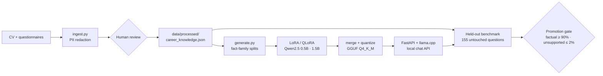

# career-model

**Can a sub-1B language model internalize one engineer's career — with no RAG, no embeddings, no vector store, and no hosted API?**

An offline fine-tuning experiment. Inference loads exactly one local GGUF file through llama.cpp. Everything else — the profile, the dataset, the benchmark, and the evaluator — is committed and inspectable.

[](https://github.com/orcnd/career-model/actions/workflows/ci.yml)
[](LICENSE)
[](tests)

---

## Status

Numbers below come from runs recorded in this repository. Nothing here is extrapolated.

| Check | Result |
|---|---|
| Unit tests (redaction, split hygiene, scoring, language/context rules) | 8/8 passing, run in CI on every push |
| Multilingual regression suite, last run | 42/54 (**77.8%**) against a 90% gate — **not promoted** |
| Held-out benchmark (155 questions: 124 supported, 31 adversarial) | requires a scored run; see [BENCHMARK_PROTOCOL.md](BENCHMARK_PROTOCOL.md) |
| Training, 1.5B CPU LoRA, 1 epoch, 757 steps | 118 min wall-clock, final train loss 0.041 ([log](experiments/logs/training-hr-tune-1.5b.log)) |

The promotion gate in [BENCHMARK_PROTOCOL.md](BENCHMARK_PROTOCOL.md) is deliberately higher than the current result, so the adapter stays unpublished until a human audit clears it.

## What it does

A recruiter asks a question in Turkish, English, Arabic, French, or Italian. The system answers from fine-tuned, documented career facts only, in the language of the question, and replies with the fixed refusal string when the profile does not support the claim:

> There is not enough evidence in the provided career information to support that claim.

That refusal is a trained, benchmark-tested behavior — not a system-prompt promise.

## Pipeline



Two properties are enforced by construction rather than by review:

- **No split leakage.** Splits are assigned by fact family (`stable_bucket` in `career_model/core.py`), so test questions are never paraphrases of training questions.
- **No silent facts.** `ingest.py` only redacts; it never writes career facts. `generate.py` refuses to run while the profile still carries `review_required`.

## Repository layout

```
career-model/
├── app/                    # local chat API: server, CLI, translation, QA layer
├── career_model/           # shared primitives: redaction, JSON I/O, split hashing
├── configs/                # committed training configs (0.5B, 1.5B, CPU, Soup)
├── data/
│   ├── benchmark/          # 155 held-out questions + regression suite + last run
│   ├── generated/          # train / validation / test splits
│   └── processed/          # reviewed profile + redacted source extract
├── scripts/
│   ├── ingest/             # PDF/text extraction with PII redaction
│   ├── dataset/            # evidence-bound example generation + splitting
│   ├── training/           # CPU LoRA trainer, API benchmark runners
│   ├── evaluation/         # deterministic scorer, runtime metrics
│   └── quantization/       # adapter merge + GGUF export
├── tests/                  # 8 unit tests, no model weights required
├── experiments/logs/       # raw training and API logs from real runs
└── BENCHMARK_PROTOCOL.md   # dimensions, promotion gate, audit format
```

`models/` (7.4 GB of weights and adapters) and `tools/` (local llama.cpp and QA-classifier checkouts) are intentionally not committed.

## Quick start

Requires Python 3.10+.

```powershell
python -m venv .venv
.\.venv\Scripts\Activate.ps1
pip install -r requirements-train.txt -r requirements-inference.txt

python scripts/ingest/ingest.py --input ..\path\to\cv.pdf
# review data/processed/career_knowledge.json by hand, then:
python scripts/dataset/generate.py
python scripts/training/train_cpu.py --config configs/qwen-0.5b-cpu.yaml
```

Run the test suite (no weights, no network):

```powershell
pip install -r requirements-dev.txt
pytest
```

Serve the chat UI:

```powershell
python scripts/quantization/merge_adapter.py          # adapter -> HF format
# then convert with llama.cpp convert_hf_to_gguf.py and llama-quantize -t q4_k_m
uvicorn app.server:app --host 127.0.0.1 --port 8765
```

The API answers `503` until a fine-tuned GGUF exists at `models/career-q4_k_m.gguf` and never falls back to a base or online model. `CAREER_MODEL_PATH` overrides the location. The UI at `http://127.0.0.1:8765` keeps 12 turns of history per session in process memory; **New chat** clears it. The optional portrait is read from `../public/` and returns 404 when absent.

### Hardware note

The development host is a Ryzen 5 5600G with 30 GB RAM and integrated graphics: no CUDA, so QLoRA is unavailable. Training here is regular LoRA over frozen FP32 weights — slow, but it produces the same mergeable adapter, and CPU inference remains the deployment target. Use `soup train --config configs/soup-qwen-0.5b.yaml` on a CUDA machine for QLoRA.

## Evaluation policy

Results are reported only after a benchmark run; the evaluator never invents numbers and uses no LLM judge.

```powershell
python scripts/evaluation/evaluate.py --answers experiments/run-001/answers.jsonl
python scripts/evaluation/benchmark_runtime.py --model models/career-q4_k_m.gguf
python scripts/training/benchmark_api.py --suite data/benchmark/regression_suite.json
```

Required metrics: factual accuracy, hallucination rate, unsupported-claim rate, completeness, negative-question accuracy, file size, peak RSS, startup time, first-token latency, throughput.

The multilingual gate runs the same fact families in Turkish, English, Arabic, French, and Italian. A response passes only if it uses the question language, preserves the documented meaning, and adds no unsupported claim. Translation is Argos, offline and English-pivoted; its language packages are downloaded once and then used without network access.

## Design decisions

**Qwen2.5-Instruct at 0.5B and 1.5B.** Apache-2.0, instruction-tuned at every size, converts cleanly to GGUF. 0.5B is the minimum viable hypothesis; 1.5B is the quality baseline. Promotion requires the held-out hallucination and negative-question results to clear the gate first.

**Soup for training, llama.cpp for serving.** [Soup](https://github.com/MakazhanAlpamys/Soup) handles QLoRA/LoRA and GGUF export; it is never an inference dependency. `scripts/training/train_cpu.py` remains as a transparent Transformers/PEFT baseline.

**A local QA classifier around the generator.** An optional 151M-parameter classifier screens inputs and outputs (`app/qa.py`) and fails open if unavailable; it lives in `tools/` and is not committed.

**No RAG.** Retrieval would answer questions the model never learned, which defeats the experiment. If the weights cannot hold the facts, that is the finding.

## License

Apache-2.0 — see [LICENSE](LICENSE). Base models are Apache-2.0 (Qwen2.5-Instruct).
